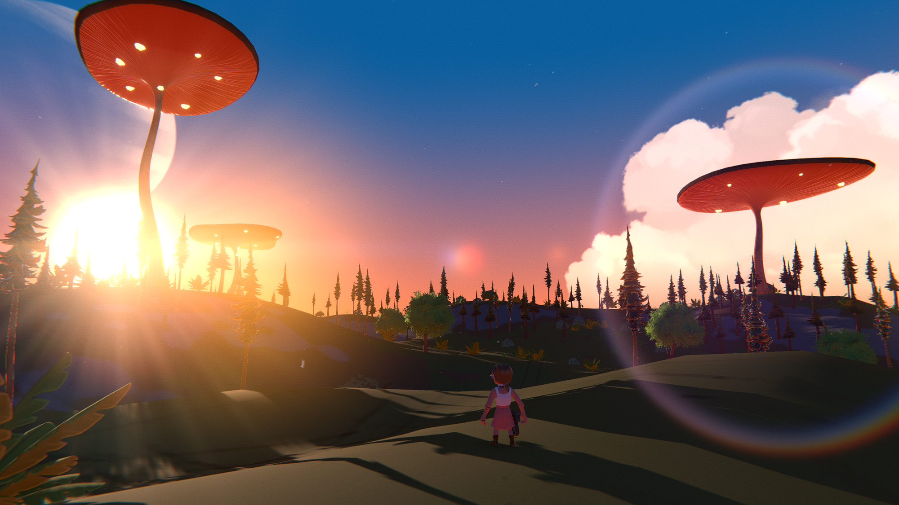
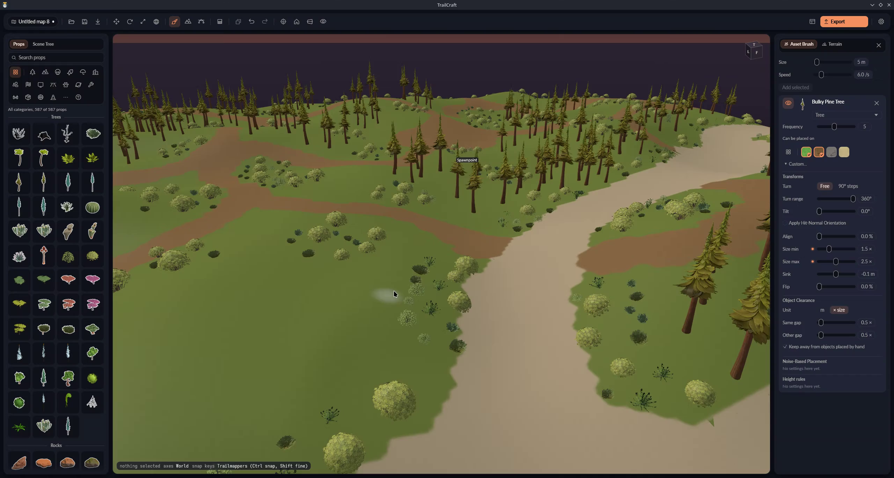
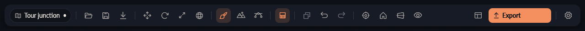
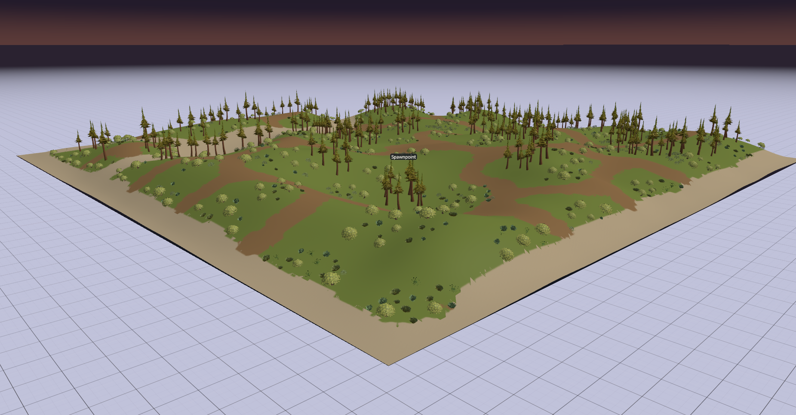

# TrailCraft



**Make a Trailmakers map in 3D. Place terrain and props, then export the map for your game.**

TrailCraft is in playtesting. If something goes wrong, or you have an idea, use one of the feedback links below.

<p align="center">
  <a href="https://github.com/LuluFur/TrailCraft-Playtest/releases/download/v0.1.0/TrailCraft-test.zip"><strong>⬇ Download TrailCraft 0.1.0 (Windows)</strong></a>
</p>



## Before you start

- A Windows 10 or 11 PC, or Linux with Proton.
- Trailmakers installed through Steam.

TrailCraft reads game props from your Trailmakers installation. The download does not include game files.

## Install on Windows

Download the ZIP using the button above. In File Explorer, right-click the ZIP and choose **Extract All**, then open the extracted folder and double-click **TrailCraft.exe**. If Windows says it protected your PC, choose **More info**, then **Run anyway**. TrailCraft is not signed yet.

TrailCraft looks for Trailmakers in your Steam library. If it cannot find the game, choose **Pick Trailmakers folder...** and select the folder containing `Trailmakers.exe`. The usual folder is:

`C:\Program Files (x86)\Steam\steamapps\common\Trailmakers`

TrailCraft remembers the folder. It creates pictures for the prop list; wait for the list to fill. Load times can vary between starts and computers and cannot be guaranteed, especially for remote clients connecting to a multiplayer server.

## Make and play a map

1. Add terrain and shape it with the terrain brush. Paint it with grass, dirt, rock or sand.
2. Find a prop in the list on the left, then drag it into the 3D view. You can move, turn and resize props there.
3. Save your map from the map controls.
4. Choose **Export**. TrailCraft puts your map in the `mods` folder inside your Trailmakers installation.
5. Start Trailmakers and load the exported map as a local mod.

Terrain exported as a custom mesh is experimental. Road and spline tools are not included in this playtest; the Spline toolbar button is disabled while they are being developed.

You can paint groups of props with the Asset Brush, import a Trailmappers save, or add your own `.obj` model.

## Known bug

Trailmakers may select the test-zone floor as the priority space for building or repairing vehicles instead of the terrain. This is a known game interaction and does not block the playtest.



## Linux with Proton

The tested Linux setup uses Steam, `umu-run`, and GE-Proton10-34. This option uses a terminal command, but you do not need to write or change code. Download and extract the ZIP. Then open a terminal, replace `/path/to/extracted/folder` with the folder you extracted, and paste:

```sh
PROTONPATH="$HOME/.local/share/Steam/compatibilitytools.d/GE-Proton10-34" \
WINEPREFIX="$HOME/trailcraft-prefix" GAMEID=0 \
umu-run "/path/to/extracted/folder/TrailCraft.exe"
```

The tested setup found Trailmakers in the Steam library. If TrailCraft cannot find it, choose **Pick Trailmakers folder...** and select the folder containing `Trailmakers.exe`.

## What you can do

### Shape terrain



- Add terrain, raise or lower the ground, smooth it, and paint ground materials.

### Place and manage props

- Search props by name or category, then drag them into the map.
- Move, rotate and resize props. Duplicate one prop or move a group together.
- Paint groups of props with the Asset Brush.
- Add your own 3D models from `.obj` files.

### Save, import and export

- Undo and redo changes; autosave can offer to restore unsaved work after a close.
- Import a Trailmappers save or a mod folder exported by Trailmappers.
- Export a map for Trailmakers. The Budget panel warns when a map is too large.

## Send feedback

- [Report a bug](https://github.com/LuluFur/TrailCraft-Playtest/issues/new?template=bug.yml)
- [Suggest a feature](https://github.com/LuluFur/TrailCraft-Playtest/issues/new?template=feature.yml)
- [Browse existing reports and ideas](https://github.com/LuluFur/TrailCraft-Playtest/issues)

For a bug report, include what happened, what you expected, and the steps you took. A screenshot is helpful. If you can, include the build value from the app log:

- **Windows:** In File Explorer, paste `%LOCALAPPDATA%\TrailCraft` into the address bar and open `trailcraft.log`.
- **Linux:** Open `~/trailcraft-prefix/drive_c/users/steamuser/AppData/Local/TrailCraft/trailcraft.log`.

In the log, find the last line containing `app.start` and copy the value after `build_sha=`. You can attach the log to your report instead if that is easier. The log can include map names and graphics details.

Thank you for helping test TrailCraft!
